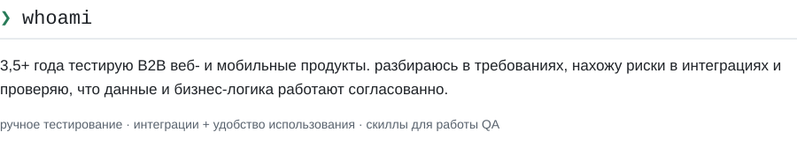

<picture>
  <source media="(prefers-color-scheme: dark) and (max-width: 600px)" srcset="https://raw.githubusercontent.com/tymchasovo/tymchasovo/main/assets/terminal/header-mobile-dark.svg?v=c01932618664">
  <source media="(max-width: 600px)" srcset="https://raw.githubusercontent.com/tymchasovo/tymchasovo/main/assets/terminal/header-mobile-light.svg?v=813a4ea4c893">
  <source media="(prefers-color-scheme: dark)" srcset="https://raw.githubusercontent.com/tymchasovo/tymchasovo/main/assets/terminal/header-dark.svg?v=80e2f0da666a">
  
</picture>

<picture>
  <source media="(prefers-color-scheme: dark) and (max-width: 600px)" srcset="https://raw.githubusercontent.com/tymchasovo/tymchasovo/main/assets/terminal/intro-mobile-dark.svg?v=f54f4222db73">
  <source media="(max-width: 600px)" srcset="https://raw.githubusercontent.com/tymchasovo/tymchasovo/main/assets/terminal/intro-mobile-light.svg?v=2848f11737e0">
  <source media="(prefers-color-scheme: dark)" srcset="https://raw.githubusercontent.com/tymchasovo/tymchasovo/main/assets/terminal/intro-dark.svg?v=5c94a81cf063">
  
</picture>

<picture>
  <source media="(prefers-color-scheme: dark) and (max-width: 600px)" srcset="https://raw.githubusercontent.com/tymchasovo/tymchasovo/main/assets/terminal/experience-mobile-dark.svg?v=f5c74a87235b">
  <source media="(max-width: 600px)" srcset="https://raw.githubusercontent.com/tymchasovo/tymchasovo/main/assets/terminal/experience-mobile-light.svg?v=11065456b9db">
  <source media="(prefers-color-scheme: dark)" srcset="https://raw.githubusercontent.com/tymchasovo/tymchasovo/main/assets/terminal/experience-dark.svg?v=6bbff6a325cb">
  
</picture>

<picture>
  <source media="(prefers-color-scheme: dark) and (max-width: 600px)" srcset="https://raw.githubusercontent.com/tymchasovo/tymchasovo/main/assets/terminal/sber-mobile-dark.svg?v=415450a369ee">
  <source media="(max-width: 600px)" srcset="https://raw.githubusercontent.com/tymchasovo/tymchasovo/main/assets/terminal/sber-mobile-light.svg?v=e98ffc18d89b">
  <source media="(prefers-color-scheme: dark)" srcset="https://raw.githubusercontent.com/tymchasovo/tymchasovo/main/assets/terminal/sber-dark.svg?v=ee3835a3f26d">
  
</picture>

<picture>
  <source media="(prefers-color-scheme: dark) and (max-width: 600px)" srcset="https://raw.githubusercontent.com/tymchasovo/tymchasovo/main/assets/terminal/timeless-mobile-dark.svg?v=2b38d1ef239a">
  <source media="(max-width: 600px)" srcset="https://raw.githubusercontent.com/tymchasovo/tymchasovo/main/assets/terminal/timeless-mobile-light.svg?v=1442e00add44">
  <source media="(prefers-color-scheme: dark)" srcset="https://raw.githubusercontent.com/tymchasovo/tymchasovo/main/assets/terminal/timeless-dark.svg?v=fd52bdbca59e">
  
</picture>

показать задачи

тестировала множественные интеграции с внешними сервисами, локализовывала дефекты и участвовала в приемке функционала. проводила ревью и демо, участвовала в технических собесах и улучшала QA-процессы

<picture>
  <source media="(prefers-color-scheme: dark) and (max-width: 600px)" srcset="https://raw.githubusercontent.com/tymchasovo/tymchasovo/main/assets/terminal/gontard-mobile-dark.svg?v=255134c08e59">
  <source media="(max-width: 600px)" srcset="https://raw.githubusercontent.com/tymchasovo/tymchasovo/main/assets/terminal/gontard-mobile-light.svg?v=3e02dd98450c">
  <source media="(prefers-color-scheme: dark)" srcset="https://raw.githubusercontent.com/tymchasovo/tymchasovo/main/assets/terminal/gontard-dark.svg?v=fa19afc0812c">
  
</picture>

показать задачи

анализировала требования и макеты, готовила тестовую документацию, проводила демо заказчикам и писала юзер гайды для конечных пользователей

<picture>
  <source media="(prefers-color-scheme: dark) and (max-width: 600px)" srcset="https://raw.githubusercontent.com/tymchasovo/tymchasovo/main/assets/terminal/toolbox-mobile-dark.svg?v=d69c91376fb6">
  <source media="(max-width: 600px)" srcset="https://raw.githubusercontent.com/tymchasovo/tymchasovo/main/assets/terminal/toolbox-mobile-light.svg?v=3dc35604a270">
  <source media="(prefers-color-scheme: dark)" srcset="https://raw.githubusercontent.com/tymchasovo/tymchasovo/main/assets/terminal/toolbox-dark.svg?v=42eb7bb4feeb">
  
</picture>

<picture>
  <source media="(prefers-color-scheme: dark) and (max-width: 600px)" srcset="https://raw.githubusercontent.com/tymchasovo/tymchasovo/main/assets/terminal/portfolio-mobile-dark.svg?v=bb7896a5052f">
  <source media="(max-width: 600px)" srcset="https://raw.githubusercontent.com/tymchasovo/tymchasovo/main/assets/terminal/portfolio-mobile-light.svg?v=759222d6473e">
  <source media="(prefers-color-scheme: dark)" srcset="https://raw.githubusercontent.com/tymchasovo/tymchasovo/main/assets/terminal/portfolio-dark.svg?v=15fc2ff15c5e">
  
</picture>

**связаться со мной**

[telegram ↗](https://t.me/tymchasovo) · [email ↗](mailto:irinaskchva2@gmail.com) · [linkedin ↗](https://www.linkedin.com/in/irina-savina-8b9194274/)
