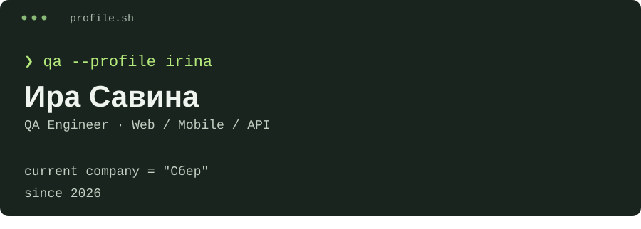
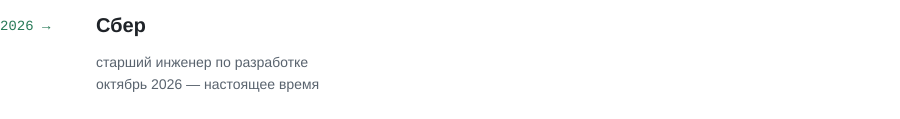
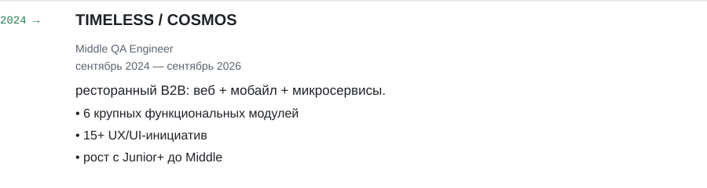
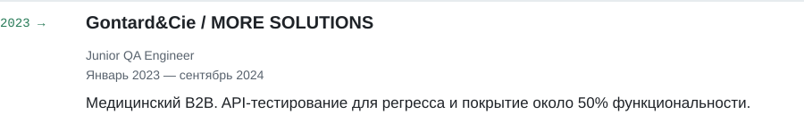
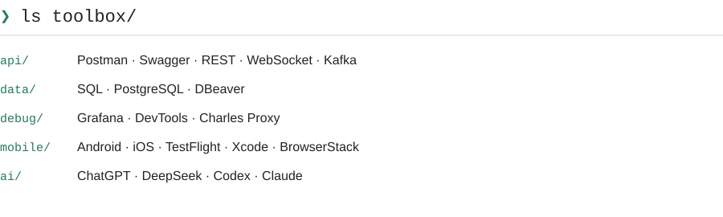

<picture>
  <source media="(prefers-color-scheme: dark) and (max-width: 600px)" srcset="assets/terminal/header-mobile-dark.svg">
  <source media="(max-width: 600px)" srcset="assets/terminal/header-mobile-light.svg">
  <source media="(prefers-color-scheme: dark)" srcset="assets/terminal/header-dark.svg">
  
</picture>

<picture>
  <source media="(prefers-color-scheme: dark) and (max-width: 600px)" srcset="assets/terminal/intro-mobile-dark.svg">
  <source media="(max-width: 600px)" srcset="assets/terminal/intro-mobile-light.svg">
  <source media="(prefers-color-scheme: dark)" srcset="assets/terminal/intro-dark.svg">
  
</picture>

<picture>
  <source media="(prefers-color-scheme: dark) and (max-width: 600px)" srcset="assets/terminal/experience-mobile-dark.svg">
  <source media="(max-width: 600px)" srcset="assets/terminal/experience-mobile-light.svg">
  <source media="(prefers-color-scheme: dark)" srcset="assets/terminal/experience-dark.svg">
  
</picture>

<picture>
  <source media="(prefers-color-scheme: dark) and (max-width: 600px)" srcset="assets/terminal/sber-mobile-dark.svg">
  <source media="(max-width: 600px)" srcset="assets/terminal/sber-mobile-light.svg">
  <source media="(prefers-color-scheme: dark)" srcset="assets/terminal/sber-dark.svg">
  
</picture>

<picture>
  <source media="(prefers-color-scheme: dark) and (max-width: 600px)" srcset="assets/terminal/timeless-mobile-dark.svg">
  <source media="(max-width: 600px)" srcset="assets/terminal/timeless-mobile-light.svg">
  <source media="(prefers-color-scheme: dark)" srcset="assets/terminal/timeless-dark.svg">
  
</picture>

показать задачи

тестировала множественные интеграции с внешними сервисами, локализовывала дефекты и участвовала в приемке функционала. проводила ревью и демо, участвовала в технических собесах и улучшала QA-процессы

<picture>
  <source media="(prefers-color-scheme: dark) and (max-width: 600px)" srcset="assets/terminal/gontard-mobile-dark.svg">
  <source media="(max-width: 600px)" srcset="assets/terminal/gontard-mobile-light.svg">
  <source media="(prefers-color-scheme: dark)" srcset="assets/terminal/gontard-dark.svg">
  
</picture>

показать задачи

анализировала требования и макеты, готовила тестовую документацию, проводила демо заказчикам и писала юзер гайды для конечных пользователей

<picture>
  <source media="(prefers-color-scheme: dark) and (max-width: 600px)" srcset="assets/terminal/toolbox-mobile-dark.svg">
  <source media="(max-width: 600px)" srcset="assets/terminal/toolbox-mobile-light.svg">
  <source media="(prefers-color-scheme: dark)" srcset="assets/terminal/toolbox-dark.svg">
  
</picture>

<picture>
  <source media="(prefers-color-scheme: dark) and (max-width: 600px)" srcset="assets/terminal/portfolio-mobile-dark.svg">
  <source media="(max-width: 600px)" srcset="assets/terminal/portfolio-mobile-light.svg">
  <source media="(prefers-color-scheme: dark)" srcset="assets/terminal/portfolio-dark.svg">
  
</picture>

**связаться со мной**

[telegram ↗](https://t.me/tymchasovo) · [email ↗](mailto:irinaskchva2@gmail.com) · [linkedin ↗](https://www.linkedin.com/in/irina-savina-8b9194274/)
