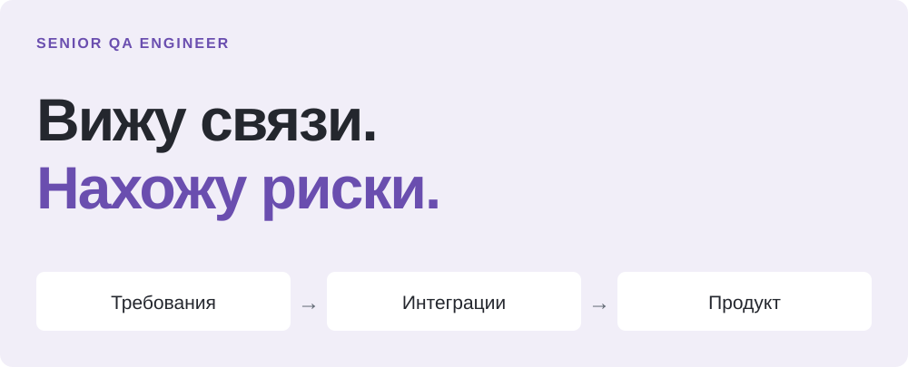

<!-- Описания, даты, достижения и стек можно редактировать прямо в этом README. -->
<!-- Баннер: assets/graphic/header-*.svg; версии для светлой/тёмной темы и мобильного экрана. -->
<picture>
  <source media="(prefers-color-scheme: dark) and (max-width: 600px)" srcset="https://raw.githubusercontent.com/tymchasovo/tymchasovo/main/assets/graphic/header-mobile-dark.svg?v=d18acdefece1">
  <source media="(max-width: 600px)" srcset="https://raw.githubusercontent.com/tymchasovo/tymchasovo/main/assets/graphic/header-mobile-light.svg?v=e5434e82e62b">
  <source media="(prefers-color-scheme: dark)" srcset="https://raw.githubusercontent.com/tymchasovo/tymchasovo/main/assets/graphic/header-dark.svg?v=42bde8a07b51">
  
</picture>

  <a href="#опыт">Опыт</a> ·
  <a href="#инструменты">Инструменты</a> ·
  <a href="https://t.me/tymchasovo">Написать мне ↗</a>

# привет, я Ира 👋

3,5+ года тестирую B2B веб- и мобильные продукты. разбираюсь в требованиях, нахожу риски в интеграциях и проверяю, что данные и бизнес-логика работают согласованно

**ручное тестирование · интеграции + удобство использования · скиллы для работы QA**

## Опыт

### 🟢 Сбер

**Senior QA Engineer** 
октябрь 2026 — настоящее время

### ◇ TIMELESS / COSMOS

**Middle QA Engineer** 
сентябрь 2024 — сентябрь 2026

ресторанный B2B: веб + мобайл + микросервисы

| Зона ответственности | Инициативы | Рост на проекте |
| :--- | :--- | :--- |
| **6 крупных функциональных модулей** | **15+ UX/UI-инициатив** | **Junior+ → Middle** |

показать задачи

· тестировала множественные интеграции с внешними сервисами, локализовывала дефекты и участвовала в приемке функционала, проводила ревью и демо, участвовала в технических собесах и улучшала QA-процессы

### ◇ Gontard&Cie / MORE SOLUTIONS

**Junior QA Engineer** 
январь 2023 — сентябрь 2024

медицинский B2B. api-тестирование для регресса и покрытие около 50% функциональности

показать задачи

анализировала требования и макеты, готовила тестовую документацию, проводила демо заказчикам и писала юзер гайды для конечных пользователей

## Инструменты

**API & интеграции** 
`Postman` `Swagger` `REST` `WebSocket` `Kafka`

**Данные & диагностика** 
`SQL` `PostgreSQL` `DBeaver` `Grafana` `DevTools` `Charles Proxy`

**Web & Mobile** 
`Android` `iOS` `TestFlight` `Xcode` `BrowserStack`

**ИИ в QA** 
`ChatGPT` `DeepSeek` `Codex` `Claude`

---

**связаться со мной**

[telegram ↗](https://t.me/tymchasovo) · [email ↗](mailto:irinaskchva2@gmail.com) · [linkedin ↗](https://www.linkedin.com/in/irina-savina-8b9194274/)
